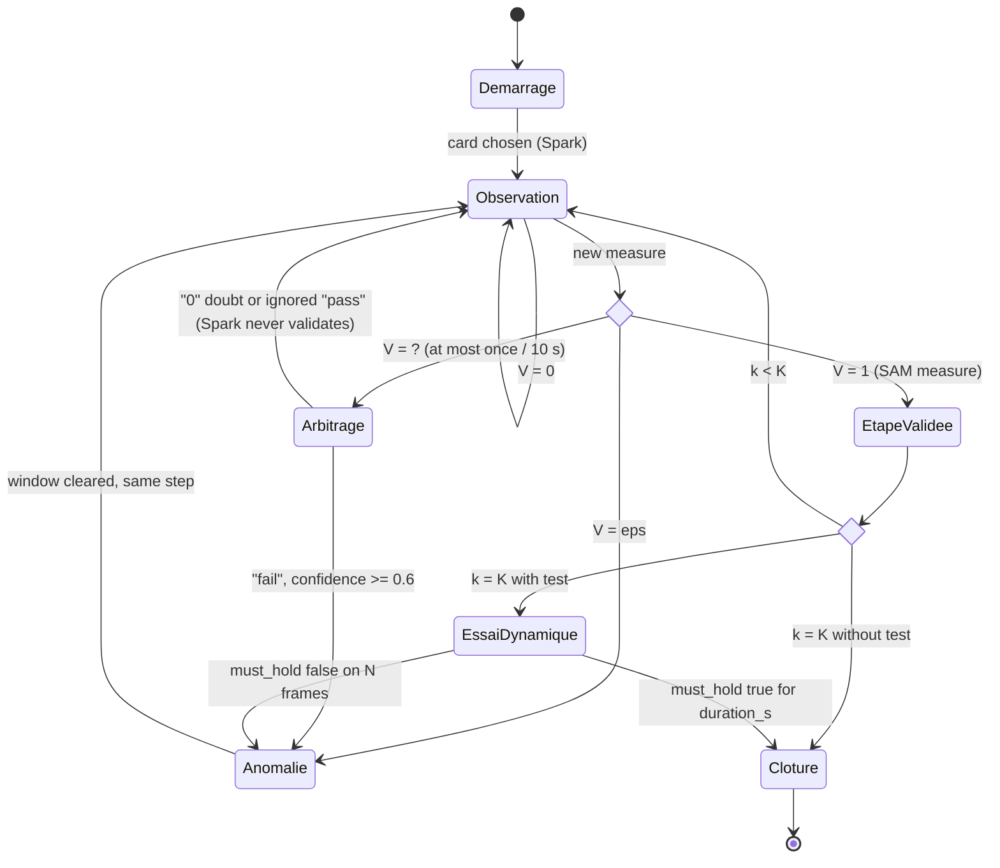

# FixLoop — a repair agent that checks what you did

Point a phone at your bike drivetrain: FixLoop diagnoses a thrown chain, guides you step by step by
voice, and only moves on once it has **measured** the step is done. A failed step is refused out loud,
shown in red, and re-checked after you fix it.

[Replay online](https://steph125.github.io/FixLoop/) · [3 min video](TBD) ·
[Benchmark report](eval/benchmark/report.md) · [Spec](spec/README.md)

## What it does

Your chain fell off the chainring and tutorials cannot tell whether you put it back right. You prop up
your phone, and FixLoop validates each step from SAM 3.1 segmentation masks: framing, seating the chain
on the teeth, back-pedalling, then a 3 s spin test. Muse Spark explains errors but never validates.

## Why it's not an image analyzer

| An image analyzer | FixLoop |
|---|---|
| One image in, one answer out | A session with a state: card chosen, step `k/K`, measure history |
| The model says what it sees | A geometric measure on SAM masks decides; the language model never validates |
| No notion of success | Each step has measurable success and anomaly criteria, with debounce |
| No action | FixLoop acts: voice prompt, highlighted part, blocked progress, final test |
| No recovery | An anomaly triggers diagnosis, guided correction, re-verification |
| No proof | A benchmark on 8 real clips compares 3 approaches, failures included (`eval/benchmark/report.md`) |

## How it works

```
phone camera → SAM 3.1 masks → contact ratio → verifier (0 / 1 / ? / eps)
     → state machine → voice + overlay → re-measure until the step holds
```

The contact ratio is the share of the chainring edge covered by the dilated chain mask (6 px edge,
6 px dilation). Chain seated: contact ≤ 0.18. Chain fallen: contact ≥ 0.26. Between the two, or when a
part is missing: uncertain. Source: `eval/day1/findings.md`.



## Meta models

| Model | ID | Role | Calling code | Proof of use |
|---|---|---|---|---|
| SAM 3.1 | `sam-3.1` | Segment chain, chainring (live image, replay video) | `fixloop/perception.py` | `eval/day1/findings.md` |
| Muse Spark | `muse-spark-1.3` | Initial diagnosis, failure arbitration, anomaly explanation | `fixloop/agent.py` | `eval/day2/findings.md` |
| Muse Wonder | `muse-wonder-1.0` | Bike history at start, closing report | `fixloop/memory.py` | `eval/day3/findings.md`, `replay/cache/` |
| Muse Voice Transcribe | `muse-voice-transcribe-1.0` | Hands-free commands ("c'est fait", "aide-moi") | `fixloop/voice.py`, `web/audio-worklet.js` | `eval/day3/findings.md`, `eval/benchmark/done_from_transcribe.csv` |
| Muse Code | CLI `muse` | Wrote the commits tagged `(Muse Code)` | — | `docs/muse-code-log.md` |

## Results

Benchmark on **8 clips** filmed on the author's bike (lamp and evening light only, 20 were planned), labelled
second by second and committed before any measure. Each number is per the whole set; per-clip figures, failed clips
and limits are in [`eval/benchmark/report.md`](eval/benchmark/report.md). The target of 0 false validations was
**not** reached.

| Approach | False validations, `live` / `replay` | Missed validations, `live` / `replay` | Spark calls per clip, `live` / `replay` |
|---|---|---|---|
| FixLoop (SAM + rules + Spark arbitration) | 1 / 6 | 0 / 1 | 1.8 / 1.1 |
| SAM rules only | 1 / 6 | 0 / 1 | 0 / 0 |
| Muse Spark alone | 0 / 0 | 1 / 1 | 4.6 / 4.6 |

`live`: 1 image/s, debounce 3. `replay`: 10 images/s, debounce 4. Source: `eval/benchmark/results.csv`.

- **The measure separates the states on these clips.** None of the 280 images labelled "off" (chain fallen or lying on
  the disc) is read as seated. Source: `eval/benchmark/confusion.csv`. The stress test below shows the limit.
- **All false validations happen with a hand in the frame.** Three are a labelling effect: the validation falls at
  the end of a second marked "hidden", just as the hand leaves a chain already seated (L1, S1, A1). The ones on clip
  B1 are a real weakness: a hand lifting the chain drops the contact, and FixLoop reads that as seated. It does not
  detect hands.
- **Spark alone makes no false validation but cannot run a repair:** it passes one step across the 8 clips and
  answers "cannot tell" on 21 of 37 images (`eval/benchmark/cache/spark_only.json`).
- **SAM misses parts on 4 clips:** no chain on L2, no chainring on L4, the chain on only part of L3 and S3. Those clips
  count as 0 errors because nothing is validated: that 0 proves nothing for them.
- **Not tested:** a chain falling during rotation, a 30° angle, daylight. FixLoop checks the chain stays seated
  during the back-pedal and spin test, not that the crank actually turns.

### Stress test (not extra clips)

SAM rules and FixLoop re-ran on 56 transformed copies of the 8 clips at the `live` setting, with the same labels and
SAM 3.1 run again on each copy. Both make the same errors on every transformation. A 0 here often means nothing was
validated, so the table also counts the clips where the seating step passes. Every clip ends with the chain seated.
Source: `eval/benchmark/robust/detail.csv`.

| Copies | False / missed | Step passed, chain seated (of 8) | Step passed wrongly |
|---|---|---|---|
| Original | 1 / 0 | 3 | 1 |
| Zoom 1.3x | 2 / 0 | 5 | 2 |
| Shifted frame | 1 / 0 | 4 | 1 |
| Darker | 0 / 0 | 1 | 0 |
| Brighter | 0 / 0 | 4 | 0 |
| Blur + noise | 1 / 0 | 2 | 1 |
| Low quality | 0 / 1 | 0 | 0 |
| 4° rotation | 0 / 0 | 5 | 0 |

- **The chain is what SAM loses first.** On low quality it never sees the chain, and it returns nothing at all on 3
  copies. Those 0 false validations mean the session waits, not that it judged well.
- **Distance matters.** Zooming in also passes the step on L3, L4 and S3, so part of those misses comes from filming
  from far away.
- **B1's false validation is not a one-off.** It stays on the zoom, shift and blur copies.
- **The best result has a limit.** 4 of the 196 "off" images are read as seated on the copies, against 0 on the
  original clips. None led to a validation.
- **Wrong part.** The S3 shifted copy passes the step while SAM takes the rear cassette for the chainring. FixLoop does
  not detect this. That pass is counted in the table above.

### Earlier measures

| Measure | Value | Source |
|---|---|---|
| False validation on `velo2` (fallen chain judged seated) | 0 / 285 images | `eval/day1/findings.md` |
| Anomaly recall on `velo2` (fallen images flagged) | 78 / 78 | `eval/day1/findings.md` |
| Verdict per image in image mode, median (p90) | 1.9 s (4.4 s) | `eval/day1/findings.md` |
| Delay of a SAM result in a real local session, median | 2.7 s | `eval/day3/findings.md` |
| Geometry cost per 848x464 image, median | 2.95 ms (target < 50 ms) | `eval/day1/findings.md` |
| First real local session, estimated cost | $0.13 (1 Spark call) | `eval/day3/findings.md` |

## Safety rule: Spark never validates

Muse Spark alone judged a fallen chain "passed" with 0.82 confidence (`eval/day2/findings.md`): the bike's black guard
disc looks like a seated chain to a generic description. So only the SAM geometry measure can pass a step; Spark may
confirm a failure, say it cannot see well, or explain. During the benchmark, an arbitration answered "passed" at 0.82
again, and the state machine ignored it (`eval/benchmark/cache/fixloop.json`).

## Try it

No bike, no key, no install: [open the replay](https://steph125.github.io/FixLoop/). Four sessions from two real videos,
recomputed by the same code as live, with model answers from cache and no sound:

- **"C'est fait" refused:** the user says it is done while the chain is not on the teeth, and FixLoop refuses and explains.
  Later in this session, FixLoop passes the step while the hand still holds the chain: the weakness described in Results.
- **Chain on the disc, then fixed:** the step stays open until the chain is put back, then the session closes.
- **Hands in front of the chainring:** a Spark arbitration, and a **real false validation** at closing (19.2 s).
- **Live setting (1 image/s):** arbitration, fix, then the real back-pedal. It does not close: during rotation the contact
  stays close to the 0.18 threshold.

The bike history shown is a prepared demo history, and the page says so. Live mode needs a server and a phone on HTTPS.
It has not yet been tried on a real phone, so it is not open to the public.

## Run locally

Windows PowerShell, one command per line (Linux/macOS: same commands with `/` paths):

```
py -3.12 -m venv .venv
.\.venv\Scripts\Activate.ps1
pip install -r requirements.txt
python -m pytest -q -m "not recorded" tests   # no API call, no key needed
python scripts/check_spec.py                  # every criterion covered by a task
node web/selftest.mjs                         # replay player logic (needs Node.js)
```

With a key (`Copy-Item .env.example .env`, then paste it): `python scripts/check_setup.py`.

The filmed clips are not in the repository, so the benchmark cannot be rerun from a fresh clone. Model answers are
committed (`eval/benchmark/cache/`), and the labels, results and report are in `eval/benchmark/`.

## Built during the hackathon

| Date | What was built | Where |
|---|---|---|
| Oct 28 | Environment check, SAM 3.1 probe, spec, first procedure, verifier + state machine | `git log --since 2026-10-26` |
| Oct 29 | First real SAM 3.1 measurements, calibrated thresholds | `eval/day1` |
| Oct 30 | Live image mode, Spark agent + safety rule, full spec | `eval/day2`, `spec/` |
| Oct 31 | Server, phone app, voice, memory, replay builder | `server/`, `web/`, `replay/` |
| Nov 1 | First real session, Transcribe and Wonder probes, benchmark + replay code | `eval/day3`, `scripts/benchmark.py` |
| Nov 2 | Clips filmed, fixes for real 30 fps videos, videos published without sound | `replay/build_replay.py` |
| Nov 3 | Labelling window, transformed copies for robustness, per-clip report | `scripts/label_clip.py`, `scripts/augment_clips.py` |
| Nov 4 | Benchmark run, replay built and published, freeze, submission before 21:00 ET | `eval/benchmark`, `replay/published`, `v1.0-submission` |

## Built with Muse Code

Commits tagged `(Muse Code)` were written by Muse Code (Muse Spark backend) and are journaled in
[`docs/muse-code-log.md`](docs/muse-code-log.md): prompt, files, tests, results. The other commits are review, fixes and
measures made outside Muse Code. Spec first: no code without a task in `spec/`, no task without tested acceptance
criteria.

## Spec

[`spec/README.md`](spec/README.md) explains spec-driven development: EARS requirements, design, atomic
tasks. `python scripts/check_spec.py` checks that every acceptance criterion is covered by a task
(83 requirements, 303 criteria, 55 decisions, 107 tasks).

## License

MIT for the code in this repository. See [NOTICE.md](NOTICE.md) for third-party components
(package licenses copied from `pip show`, model terms, demo media).

