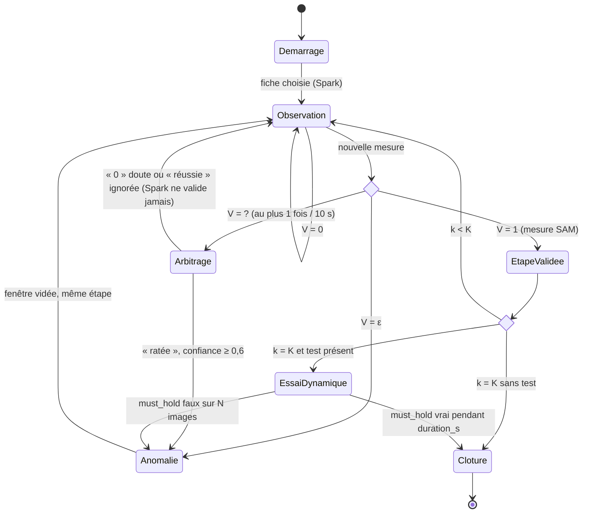

# 01 — Boucle de vérification : conception

Couvre `CORE-R1` à `CORE-R12`. Fichiers : `fixloop/models.py`, `procedures.py`, `geometry.py`, `verifier.py`,
`state_machine.py`, `sim.py`, `procedures/*.json`, `spec/procedure_schema.json`.

## 1. Vue d'ensemble

```
FrameMasks ──► geometry.measure ──► Measures ──► Session.on_measures ──► verifier.verify ──► Verdict
 (02-perception)                                     │                                          │
                                                     ├── Agent (03) : diagnose / arbitrate / explain
                                                     ├── Memory (04) : load / save
                                                     └── Output (05) : say / highlight / state
```

Principe : **une étape n'est validée que sur preuve géométrique**. La boucle rapide (SAM + géométrie) observe en
continu ; Muse Spark n'est appelé qu'au démarrage, en cas de doute ou d'anomalie. Toute la logique de ce dossier
est **synchrone, pure et sans réseau** : elle se teste avec `fixloop/sim.py` et des faux objets.

## 2. Modèles de données (`fixloop/models.py`)

```python
@dataclass
class FrameMasks:
    frame_index: int
    t: float                          # secondes depuis le début de la session
    masks: dict[str, np.ndarray]      # pièce -> masque booléen plein cadre (H, W) ; pièce absente = clé absente
    confidence: dict[str, float]      # pièce -> meilleure confiance SAM

@dataclass
class Measures:
    frame_index: int
    t: float
    detected: dict[str, bool]                  # pièce -> au moins 1 pixel
    contact: dict[tuple[str, str], float]      # (a, b) -> [0, 1], NaN si a ou b absent

@dataclass
class Verdict:
    value: Literal["0", "1", "?", "eps"]
    rule: dict | None = None          # règle qui a décidé
    evidence: dict = {}               # mesures (affichées en démo, journalisées)
    message: str | None = None        # message d'anomalie ou conseil de cadrage
```

## 3. Fiches de réparation

### 3.1 Schéma (`spec/procedure_schema.json`, JSON Schema 2020-12)

| Champ | Type | Obligatoire | Rôle |
|---|---|---|---|
| `id` | chaîne `^[a-z0-9_]+$` | oui | identifiant, nom du fichier |
| `title` | chaîne | oui | lu à l'utilisateur au diagnostic |
| `symptoms` | liste de chaînes | non | aide au diagnostic Spark |
| `notes` | chaîne | non | lecture des mesures, transmise à Spark (`AGT-R3`) |
| `visual_cues` | chaîne | non | repères propres au vélo, transmis à Spark (`AGT-R3`) |
| `parts` | objet `clé -> prompt SAM` | oui | une requête SAM par pièce |
| `select` | objet `clé -> "largest"` | non | ne garder que le plus gros objet |
| `steps[]` | liste d'étapes (≥ 1) | oui | voir 3.2 |
| `dynamic_test` | objet | non | `instruction`, `duration_s`, `must_hold[]` |

### 3.2 Étape et règles

Étape : `id`, `instruction` (< 20 mots), `highlight[]`, `success[]` (≥ 1), `anomaly[]`, `requires_done`
(défaut faux), `debounce_frames` (surcharge locale, rare).

| Type de règle | Champs | Vraie si |
|---|---|---|
| `detected` | `part` | `detected[part]` |
| `absent` | `part` | `not detected[part]` |
| `contact_ratio_min` | `a`, `b`, `threshold` | contact ≥ seuil (NaN : faux) |
| `contact_ratio_max` | `a`, `b`, `threshold` | contact ≤ seuil (NaN : faux) |

Une règle d'anomalie porte aussi `message` (lu si l'agent est muet) et `when` : `always` (défaut) ou `after_done`.

### 3.3 Fiche de référence `chain_off_chainring`

| Étape | Succès | Anomalie | Particularité |
|---|---|---|---|
| `frame_view` | chaîne et plateau détectés | — | |
| `engage_top_teeth` | contact ≤ 0,18 | contact ≥ 0,26 | anomalie `after_done` : chaîne tombée au départ, ce n'est pas une erreur |
| `turn_backward` | contact ≤ 0,18 | contact ≥ 0,26 | `requires_done` : la chaîne est déjà en place, il faut le « c'est fait » |
| test dynamique | 3 s avec contact ≤ 0,18 | | |

Entre 0,18 et 0,26 : ni succès ni anomalie, la zone d'hésitation mène à `?` après « c'est fait ».

## 4. Géométrie (`fixloop/geometry.py`)

- `outer_edge(mask, px=6)` : contours extérieurs (`cv2.findContours`, `RETR_EXTERNAL`) tracés avec une épaisseur
  de `px` pixels. Les trous intérieurs du masque sont ignorés.
- `contact_ratio(a, b)` : `|dilate(a, ellipse 13×13) ∩ outer_edge(b)| / |outer_edge(b)|`, NaN si `a` ou `b` est
  `None` ou vide.
- `contact_pairs(procedure)` : ensemble des paires `(a, b)` citées par les règles (succès, anomalie, `must_hold`).
- `measure(fm, procedure)` : `detected` pour chaque pièce de `parts`, `contact` pour chaque paire.

Pourquoi « bord du plateau couvert » et pas « recouvrement » : mesuré le 29 oct., la chaîne posée sur les dents est
fusionnée par SAM dans le masque du plateau ; elle ne touche son bord qu'aux points d'entrée et de sortie
(environ 0,09). Tombée, elle longe le plateau (environ 0,34). Voir le journal des décisions, `CORE-D3`.

## 5. Vérificateur (`fixloop/verifier.py`)

`verify(step, window, user_done, n) -> Verdict`, évalué à chaque nouvelle mesure :

```
si len(window) < n                              -> "0"
recent = window[-n:]
pour chaque règle d'anomalie :
    si when == after_done et non user_done      -> ignorer
    si vraie sur toutes les images de recent    -> "eps" (rule, evidence, message)
si toutes les règles de succès vraies sur recent
   et (user_done ou non requires_done)          -> "1"
si user_done                                    -> "?"
sinon                                           -> "0"
```

`holds(rules, window)` : vrai si toutes les règles sont vraies sur toute la fenêtre (test dynamique).
`evidence` = dernière image : `frame`, `detected`, `contact` arrondi à 3 décimales (clés `"a/b"`).

## 6. Machine à états (`fixloop/state_machine.py`)

### 6.1 États

| État | Ce qui se passe | Modèles Meta |
|---|---|---|
| `DEMARRAGE` | Historique du vélo, diagnostic sur 1 à 3 images, choix de la fiche | Wonder, Spark |
| `OBSERVATION` | Mesures sur l'étape `k`, verdict à chaque image, rien n'est dit si `V = 0` | SAM |
| `ARBITRAGE` | `V = ?` : Spark regarde 2 à 3 images clés, peut confirmer un échec ou conseiller, **jamais valider** | Spark |
| `ANOMALIE` | Explication, consigne vocale, pièce en rouge | Spark |
| `ETAPE_VALIDEE` | « C'est bon. », passage à `k+1` | — |
| `ESSAI_DYNAMIQUE` | Pédalier tourné `duration_s` secondes, `must_hold` vérifié à chaque image | SAM |
| `CLOTURE` | Rapport écrit dans l'historique | Wonder |

`ARBITRAGE`, `ANOMALIE` et `ETAPE_VALIDEE` sont transitoires : traités dans le même appel à `on_measures`, la
session revient en `OBSERVATION` (ou passe en `ESSAI_DYNAMIQUE` / `CLOTURE`). Le serveur (`05`) les voit dans le
journal, jamais comme état durable.

### 6.2 Diagramme



### 6.3 Interface

```python
class Agent(Protocol):                       # 03-agent-spark
    def diagnose(self, images, procedures, history: str) -> str: ...          # id de fiche
    def arbitrate(self, step, keyframes, window: list[Measures]) -> Verdict: ... # "eps" ou "0"
    def explain(self, step, verdict, keyframes) -> tuple[str, str | None]: ...  # phrase, pièce
    def help(self, step, keyframes) -> str: ...                                 # CORE-R12.2 (à ajouter)

class Memory(Protocol):                      # 04-memory-voice
    def load(self, bike_id: str) -> str: ...
    def save(self, bike_id: str, report: dict) -> None: ...

class Output(Protocol):                      # 05-session-server
    def say(self, text: str) -> None: ...
    def highlight(self, parts: list[str], color: str) -> None: ...   # "blue" | "red" | "green"
    def state(self, snapshot: dict) -> None: ...                     # CORE-R11 (à ajouter)

class Session:
    def __init__(self, procedures, agent, memory, out, bike_id, *, debounce_frames=4,
                 anomaly_cooldown_s=8.0, arbitration_cooldown_s=10.0, framing_timeout_s=6.0,
                 keyframes_kept=3): ...
    def start(self, images) -> None
    def on_measures(self, m: Measures, keyframe=None) -> None
    def on_user_done(self) -> None
    def on_command(self, cmd: Literal["repeat", "help"]) -> None     # CORE-R12 (à ajouter)
    def snapshot(self) -> dict                                       # CORE-R11 (à ajouter)
    log: list[dict]; model_calls: dict[str, int]; state: State
```

Les images clés (`keyframe`) sont fournies par l'appelant : en direct, le JPEG reçu ; en replay, l'image décodée.
La session garde les `keyframes_kept` dernières et ne les journalise jamais (`CORE-R8.3`).

### 6.4 Règles temporelles

| Règle | Valeur | Implémentation |
|---|---|---|
| Anti-rebond `N` | 3 en direct, 4 en replay | `debounce_frames` de session, passé à `verify` et au test dynamique |
| Anti-répétition des anomalies | 8 s par message | `suppressed[message] = t + 8` |
| Arbitrage | 1 fois / 10 s | `next_arbitration_t` |
| Perte de cadrage | 6 s sans pièce requise, message répété au plus toutes les 10 s | `last_seen[pièce]`, `next_framing_t` |

Le temps est celui des mesures (`m.t`), jamais l'horloge système : la session est rejouable à l'identique.

Pièces « requises » d'une étape (`CORE-R10`) : pièces citées par ses règles de succès.

### 6.5 Instantané (`snapshot`)

```json
{"state": "OBSERVATION", "procedure": {"id": "chain_off_chainring", "title": "Chaîne tombée du plateau"},
 "step": {"index": 2, "count": 3, "id": "engage_top_teeth", "instruction": "Pose la chaîne…"},
 "verdict": "0", "contact": {"chain/chainring": 0.312}, "user_done": false,
 "model_calls": {"spark": 1, "wonder": 1}, "t": 14.2}
```

`step.index` commence à 1. Émis par `Output.state` à chaque changement d'état, d'étape ou de verdict.

## 7. Journal d'événements

Une ligne JSON par événement, dans `Session.log`, exportée par le serveur dans `data/sessions/<id>.jsonl`.

```json
{"t": 16.8, "event": "validated", "state": "ETAPE_VALIDEE", "step": "engage_top_teeth",
 "evidence": {"frame": 168, "detected": {"chain": true, "chainring": true}, "contact": {"chain/chainring": 0.091}},
 "model_calls": {"spark": 1, "wonder": 1}}
```

| `event` | Champs en plus |
|---|---|
| `diagnose` | `procedure` |
| `step` | `step` |
| `user_done` | — |
| `validated` | `step`, `evidence` |
| `anomaly` | `step`, `message`, `evidence`, `source` (`rule` ou `muse-spark`) |
| `arbitrate` | `verdict`, `evidence` (dont `confiance`, `verdict_brut`, `ignore`) |
| `framing_lost` | `part` |
| `command` | `cmd` |
| `dynamic_start` | — |
| `closed` | `success` |

## 8. Erreurs et cas limites

| Cas | Comportement |
|---|---|
| Agent lève une exception ou rend `None` | La session attrape : diagnostic → 1re fiche ; arbitrage → `0` + conseil par défaut ; explication → `message` de la règle |
| Diagnostic rend un id inconnu | 1re fiche chargée (`AGT-R1.3`) |
| Mesure arrivée hors ordre (`t` inférieur au dernier) | Ignorée (le serveur peut livrer des réponses SAM dans le désordre, `PERC-D3`) |
| `on_user_done` hors `OBSERVATION` / `ESSAI_DYNAMIQUE` | Ignoré, journalisé |
| `on_measures` en `CLOTURE` | Ignoré |
| Fiche sans `dynamic_test` | Clôture après la dernière étape |

## 9. Tests

| Test | Fichier | Critères |
|---|---|---|
| Contact sépare en place / tombée (scène synthétique) | `test_geometry_verifier.py` | R2.2 |
| Pièce absente : NaN | idem | R2.3, R3.7 |
| Moins de N mesures : `0` ; succès après N ; scintillement ne valide pas | idem | R3.1, R3.3 |
| Anomalie `after_done` ; incertain si chaîne cachée ; `requires_done` | idem | R3.5, R3.6, R3.3 |
| Parcours complet jusqu'à la clôture | `test_state_machine.py` | R4 |
| Anomalie puis correction ; anti-répétition | idem | R5 |
| Incertain : Spark une fois puis la géométrie décide ; échec confirmé | idem | R7 |
| Échec du test dynamique : retour à la dernière étape | idem | R6.3 |
| À écrire : priorité `eps` > `1`, N de session, cadrage perdu, instantané, commandes, agent qui lève, mesures hors ordre, chronomètre du test dynamique, journal JSONL | `test_state_machine.py`, `test_geometry_verifier.py` | R3.4, R3.8, R6.4, R8, R9, R10, R11, R12 |

## 10. Journal des décisions

- **CORE-D1 (28 oct.)** — Logique pure et synchrone, modèles injectés. Raison : tests sans réseau, replay
  déterministe, même code en direct et en replay.
- **CORE-D2 (28 oct.)** — Priorité `eps` > `1` : manquer une erreur coûte plus cher qu'un faux refus.
- **CORE-D3 (29 oct.)** — Contact inversé : le « bord couvert » est **faible** quand la chaîne est en place.
  Seuils inversés (succès ≤ 0,18, anomalie ≥ 0,26), scène synthétique et tests corrigés (`eval/day1`).
- **CORE-D4 (29 oct.)** — Anomalie `after_done` sur `engage_top_teeth` : la chaîne est tombée au départ, la
  signaler avant que l'utilisateur ait agi serait absurde. `requires_done` sur `turn_backward` : la chaîne est déjà
  mesurée en place à la fin de l'étape précédente, sans « c'est fait » l'étape serait validée immédiatement.
- **CORE-D5 (30 oct.)** — L'arbitrage ne rend jamais `1` (`AGT-D1`) et est limité à une fois toutes les 10 s
  (avant : un appel à chaque image incertaine).
- **CORE-D6 (30 oct.)** — Anti-rebond de session : 3 en direct (1 image/s, verdict environ 4 à 5 s après le geste),
  4 en replay (10 images/s). Le code actuel fige 4 dans `DEFAULT_DEBOUNCE` : à rendre paramétrable (`CORE-T9`).
- **CORE-D7 (30 oct.)** — Pas d'appel d'outils (tool calling) pour Spark : la machine à états garde la main et
  demande des réponses JSON courtes. Raison : contrôle total des transitions, règle « Spark ne valide jamais »
  impossible à contourner, moins de latence.
