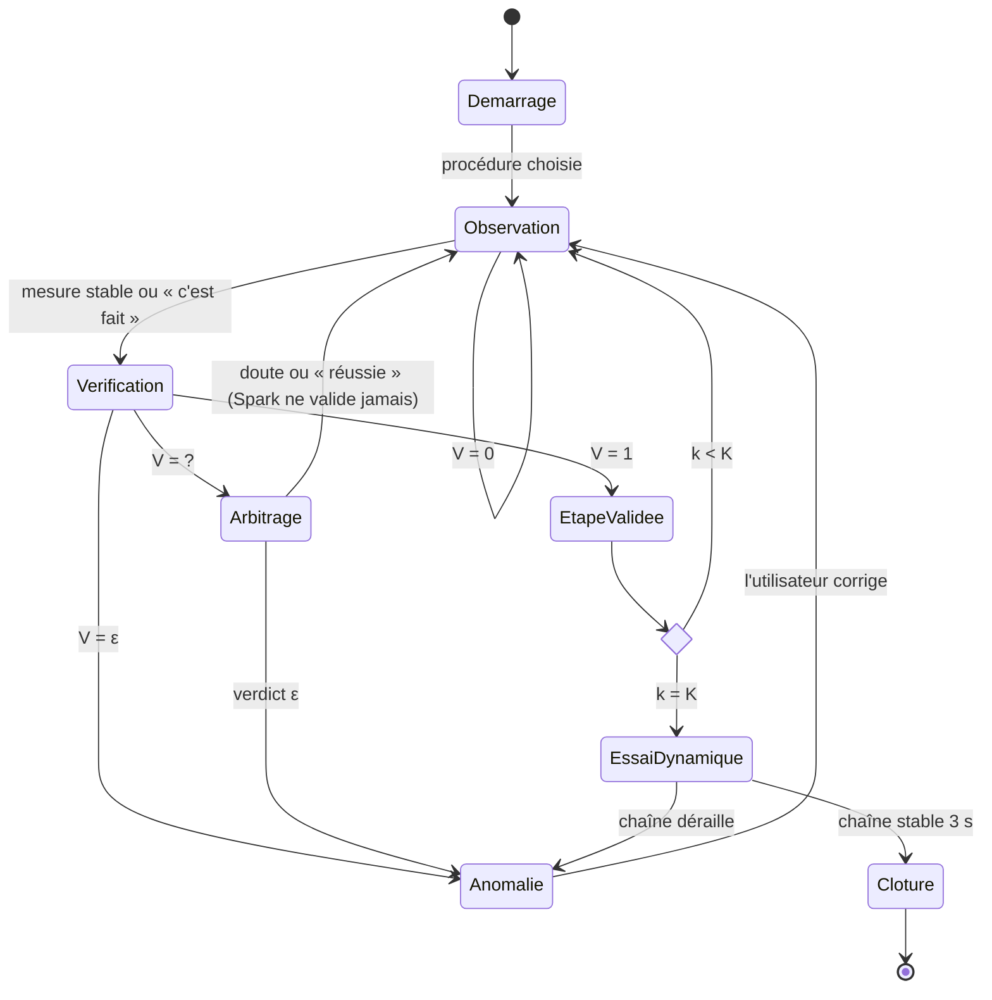

# Spec 1 — Machine à états de FixLoop

Statut : brouillon du 28 oct. Les seuils marqués *provisoire* seront fixés avec les mesures de la sonde SAM (jour 1).

## Principe

Une étape de réparation n'est validée que sur **preuve visuelle**. Une boucle rapide (SAM 3.1 + géométrie)
observe en continu ; Muse Spark n'est appelé qu'au démarrage, en cas de doute ou en cas d'anomalie.

## États

| État | Ce qui se passe | Modèles Meta |
|---|---|---|
| `DEMARRAGE` | Lecture de l'historique du vélo, diagnostic initial sur 1–3 images, choix de la procédure | Muse Wonder, Muse Spark |
| `OBSERVATION` | Mesures géométriques sur l'étape `k`, rien n'est dit à l'utilisateur | SAM 3.1 |
| `VERIFICATION` | Calcul du verdict `V` pour l'étape `k` | — (règles) |
| `ARBITRAGE` | Mesure ambiguë : Spark regarde 2–3 gros plans. Il peut confirmer un échec ou donner un conseil de cadrage, **jamais valider** (eval/day2). Au plus une fois toutes les 10 s | Muse Spark |
| `ANOMALIE` | Erreur détectée : explication, consigne vocale, pièce surlignée en rouge | Muse Spark |
| `ETAPE_VALIDEE` | Confirmation vocale, passage à `k+1` | — |
| `ESSAI_DYNAMIQUE` | Après la dernière étape : pédalier tourné 3 s, la chaîne doit rester en place | SAM 3.1 |
| `CLOTURE` | Rapport de session écrit dans l'historique du vélo | Muse Wonder |

## Verdict d'une étape

Pour l'étape `k`, sur une fenêtre glissante des `N` dernières images analysées :

| Verdict | Condition | Suite |
|---|---|---|
| `V = 1` conforme | toutes les règles `success` de l'étape vraies sur `N` images consécutives | `ETAPE_VALIDEE` |
| `V = ε` anomalie | une règle `anomaly` vraie sur `N` images consécutives | `ANOMALIE` |
| `V = ?` incertain | « c'est fait » prononcé mais ni succès ni anomalie stable, ou pièce clé non détectée | `ARBITRAGE` |
| `V = 0` en cours | aucun des cas ci-dessus | reste en `OBSERVATION` |

- Anti-rebond : `N = 4` images (*provisoire*, entre 3 et 5).
- Priorité : `ε` l'emporte sur `1` si les deux sont vrais (rappel prioritaire sur les erreurs).
- Délai : sans verdict stable 20 s après « c'est fait », passage en `ARBITRAGE`.

## Diagramme

## Événements journalisés

Chaque transition écrit une ligne JSON (`state`, `step`, `verdict`, `measures`, `model_calls`, `t`).
Ce journal sert au jeu d'évaluation et au chiffre « appels Spark économisés » du README.
